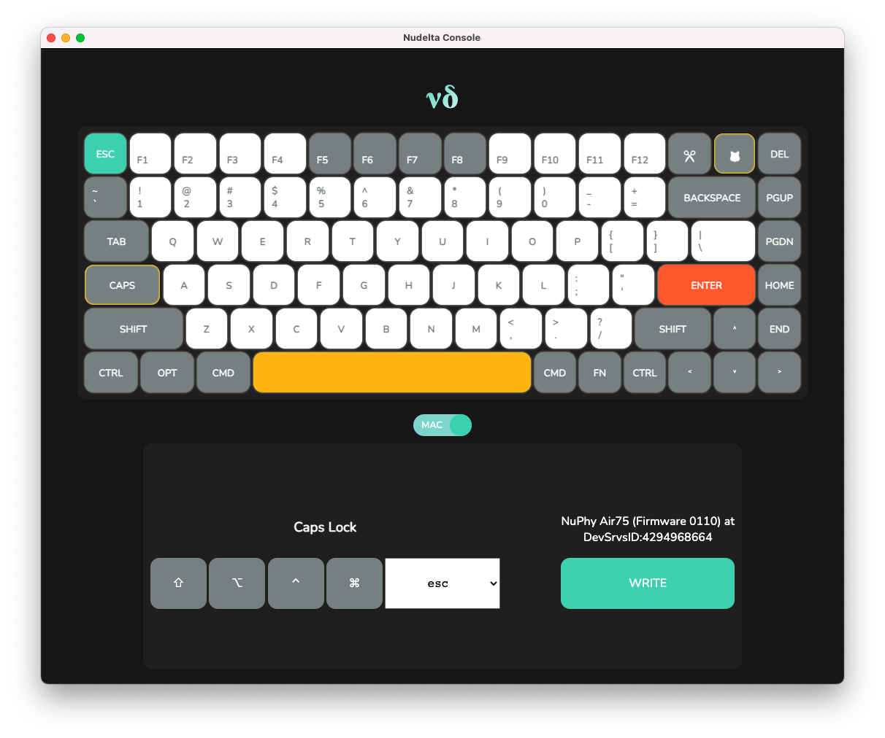

> NuPhy® is a registered trademark of NuPhy Studio.
> Nudelta is an unofficial product and is not affiliated with NuPhy Studio.
>
> Nudelta only supports Air75/Halo75 V1.
>
> * For V1 of the Halo line (65/75/90), try [Nuga](https://github.com/mishamyrt/nuga-app)
> * For Air75/Halo75 V2: Use QMK/VIA (open-source), see https://nuphy.com/pages/via-usage-guide-for-nuphy-keyboards
> * For later Air75 keyboards (including HE), Use [nuphy.io](https://nuphy.io) (proprietary).

<h1 align="center"> ν∂ / Nudelta </h1>
<p align="center">
    <a href="https://opensource.org/licenses/GPL-3.0"></a>
    
</p>


<h3 align="center">

[Download](https://github.com/donn/nudelta/releases/latest)

</h3>




An open-source alternative to the [NuPhy Console](https://nuphy.com/pages/nuphy-console) created by reverse-engineering the keyboards' USB protocol.

What this has:
* Support for NuPhy Air75 V1 and Halo75 V1 on Windows 10+, macOS 11.3+, and Linux
* Loading and saving keymap modifications from a `.yml` configuration file
* The ability to back up and dump keymaps to binary formats (CLI)
* The ability to dump keymaps to a human-readable hex format (CLI)

What this DOESN'T have:
* Macros
* Support for Air60, Halo65, etc.
    * I don't have them.
* Support for keyboards that do not use the NuPhy Console (incl. Air75 V2/V3/HE)
    * They use a different protocol.
* RGB Control
    * I don't need that, personally.

Contributions are super appreciated for all of these.


## Running Requirements

* Windows 10 or higher
* macOS 11.3+ or higher (Intel or Apple Silicon)
* Linux 2.6.39 or higher with glibc 2.17 or higher.

### Build/Development Requirements

* C++17 Compiler
    * Clang recommended for macOS/Linux
    * MSVC recommended for Windows
* CMake
* pkg-config
* Node 22+ with Yarn
* Ruby 2.0.0+ (glue scripts)

## Build

```sh
git clone https://github.com/donn/nudelta
cd nudelta
git submodule update --init --recursive
rm -rf build
yarn
yarn build_native # CLI / Library
yarn build # GUI
```

The Linux AppImage will be found under ./dist, and the Mac app will be found under ./dist/mac.

### Nix

If you have Nix on either macOS or Linux, you can build and run nudelta
using `nix run github:donn/nudelta`.

On NixOS, you will need to add the requisite udev rule as follows:

```nix
services.udev.extraRules = ''
  # Hidraw for Seated Users (This rule requires a reboot)
  KERNEL=="hidraw*", SUBSYSTEM=="hidraw", TAG+="uaccess"
'';
```

## Using the CLI

You may need to use **sudo** on Linux. On macOS, you will need to grant Input
Monitoring permissions to whichever Terminal host you're using to run Nudelta,
likely Terminal.app.

No special permissions are required on Windows as far as I can tell.

### Load a custom profile

```sh
nudelta -l ./donns_remap.yml
```

The configuration .yml file is simple: there's a top level object called "keys": which is a map of physical keys on the actual keyboard to their replacements:

```yml
keys:
    capslock: esc
```

See [example.yml](example.yml) for a profile and somewhat more detailed examples.

You can find a list of:
  * Replaceable keys (for the Windows mode) in [res/air75/indices_win.yml](res/Air75/indices_win.yml).
  * Replacement keycodes in [res/air75/default_keymap_win.yml](res/Air75/default_keymap_win.yml).

### Reset keymap to default
```sh
nudelta -r
```

## License
The GNU General Public License v3 or, at your option, any later version. Check '[License](./License)'.

## Contributing
Hex dumps for the Air96 V1 and Halo96 V1 keymaps are available in [util/usb](./util/usb).

PRs to add support for them appreciated.
